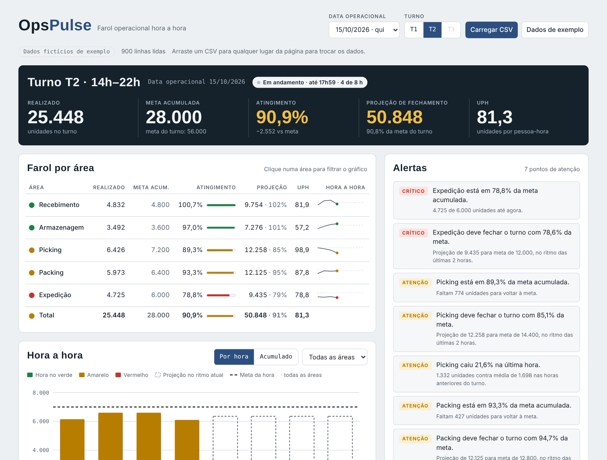

# OpsPulse

**Farol operacional hora a hora para qualquer operação que tenha meta por hora.**
Suba um CSV de produção e veja, em segundos, quais áreas estão fora da meta, como o turno deve fechar no ritmo atual e um resumo pronto para mandar no grupo da operação.

[](https://github.com/sewzehcompanysp-afk/opspulse/actions/workflows/ci.yml)


**[Abrir a demo ao vivo](https://sewzehcompanysp-afk.github.io/opspulse/)**: abre com dados de exemplo, sem login e sem instalar nada.



---

## O problema

Em centros de distribuição, fábricas e operações de atendimento, o acompanhamento hora a hora costuma viver em planilhas copiadas e coladas a cada hora. A pergunta que o supervisor precisa responder é sempre a mesma: *qual área está atrasada agora, e o turno vai bater a meta?* Responder isso à mão toma tempo e chega tarde.

## O que o OpsPulse faz

| Recurso | Como funciona |
|---|---|
| **Farol por área** | Verde, amarelo ou vermelho pelo atingimento da meta acumulada. Limites ajustáveis (padrão 95% e 85%). |
| **Projeção de fechamento** | Realizado + ritmo médio das últimas 2 horas × horas que faltam no turno. |
| **Turno que vira a meia-noite** | O T3 (22h–06h) é tratado pela data operacional: 02h do dia 16 conta no T3 do dia 15. |
| **Alertas automáticos** | Área abaixo do limite, projeção abaixo da meta e queda de ritmo maior que 15% na última hora. |
| **Resumo para o grupo** | Texto formatado para WhatsApp ou Teams, com um clique para copiar. |
| **UPH** | Unidades por pessoa-hora, quando o arquivo traz a coluna de headcount. |
| **Leitura flexível** | Aceita vírgula, ponto e vírgula ou tabulação, datas `2026-10-15` ou `15/10/2026`, números `1.234,5` e nomes de coluna em português ou inglês. |

## Três implementações, mesma regra

O mesmo cálculo foi escrito em três linguagens, cada uma no lugar onde ela faz mais sentido numa empresa. Um teste automatizado confere que as versões SQL e Python chegam aos mesmos números.

| Versão | Para quem | Pasta |
|---|---|---|
| **Web (HTML + JavaScript puro)** | Supervisor que só quer abrir um link e arrastar o arquivo. Roda 100% no navegador; o arquivo não sai do computador. | [`web/`](web/) |
| **Python (pandas + Streamlit)** | Analista que quer evoluir a análise, ligar em outras fontes ou publicar no Streamlit Cloud. | [`python/`](python/) |
| **SQL (views)** | Quando os dados já estão num banco: as views alimentam Looker Studio, Power BI ou Metabase direto. | [`sql/`](sql/) |

### Regras de cálculo

```
atingimento   = realizado / meta acumulada das horas com dado
meta do turno = meta acumulada + (meta média por hora × horas que faltam)
projeção      = realizado + (média das 2 últimas horas × horas que faltam)
UPH           = realizado / soma do headcount (pessoas-hora)
farol         = verde ≥ 95% · amarelo ≥ 85% · vermelho abaixo
turnos        = T1 06h–14h · T2 14h–22h · T3 22h–06h
```

## Como usar

### Web

Abra a [demo](https://sewzehcompanysp-afk.github.io/opspulse/) ou o arquivo `web/index.html` direto no navegador. Clique em **Carregar CSV** ou arraste o arquivo para a página.

Para alterar a página, edite `web/index.template.html` e rode `python web/build.py`. O script embute a base de exemplo e gera o `index.html` final.

### Python

```bash
cd python
pip install -r requirements.txt
streamlit run app.py
```

Testes:

```bash
pip install -r requirements-dev.txt
pytest -q
```

O núcleo de cálculo (`opspulse_core.py`) não depende do Streamlit e pode ser usado em scripts e notebooks:

```python
import opspulse_core as core

df = core.ler_csv("../data/exemplo_producao.csv")
res = core.resumir(df, "2026-10-15", "T2")
print(core.resumo_texto(res, core.alertas(res)))
```

### SQL

```bash
sqlite3 opspulse.db < sql/schema.sql
sqlite3 opspulse.db -cmd ".import --csv --skip 1 data/exemplo_producao.csv producao" < sql/kpis.sql
```

As views criadas são `v_base`, `v_hora_a_hora`, `v_area_turno`, `v_total_turno` e `v_alertas`.

## Formato do arquivo

Uma linha por área e por hora:

```csv
data,hora,area,volume,meta,headcount
2026-10-15,14,Picking,1800,1800,15
2026-10-15,14,Expedição,1200,1500,15
```

| Coluna | Obrigatória | Também aceita |
|---|---|---|
| `data` | sim | date, dia |
| `hora` | sim* | hour, horario, faixa (*ou a hora junto da data: `2026-10-15 14:00`) |
| `area` | sim | setor, processo, etapa |
| `volume` | sim | realizado, qtd, quantidade |
| `meta` | sim | target, planejado |
| `headcount` | não | hc, pessoas, colaboradores |

A base em `data/exemplo_producao.csv` é **100% fictícia**, gerada por `data/gerar_exemplo.py`: 8 dias, 3 turnos e 5 áreas, com o último turno em andamento e algumas áreas fora da meta de propósito.

## Estrutura

```
opspulse/
├── data/       base fictícia e o gerador
├── web/        app no navegador (template + build)
├── python/     núcleo pandas, app Streamlit e testes
├── sql/        schema e views de KPI
├── docs/       imagens do README
└── .github/    testes automáticos e publicação no GitHub Pages
```

## Próximos passos

- [ ] Configurar os horários dos turnos pela interface
- [ ] Histórico de turnos com tendência semanal por área
- [ ] Conector para Google Sheets como fonte de dados
- [ ] Exportar o resumo do turno em PDF

## Autor

**Sewzeh**: analista de planejamento operacional e dados, com background em logística e estudante de Ciência de Dados na FATEC. O OpsPulse nasceu de rotinas reais de acompanhamento hora a hora em operação de fulfillment, reescritas aqui de forma genérica e com dados fictícios.

Licença [MIT](LICENSE).
